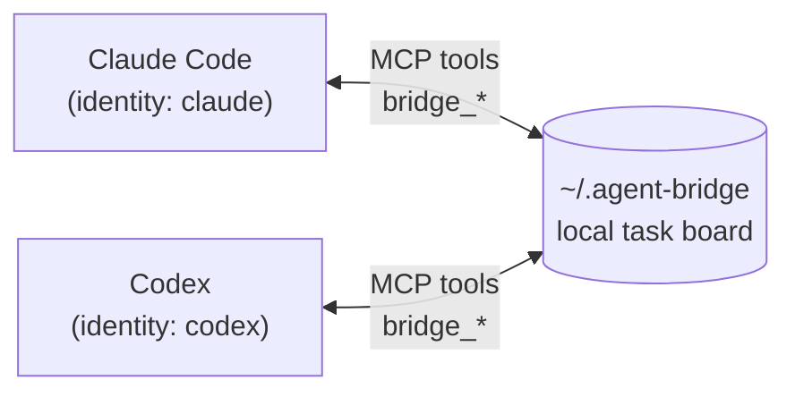

# Claude Bridge

**Connect Claude Code and Codex on one computer so they can send each other
tasks, ask questions, review each other's work, and reply, both ways.**

<p align="center">
  
  
  
  
</p>

Claude Bridge is a ready-to-use packaging of
[Agent Bridge](https://github.com/xyva-yuangui/agent-bridge) by **圆规 (Yuangui)**
([@xyva-yuangui](https://github.com/xyva-yuangui)), set up and tested for a
two-way **Claude Code ⇄ Codex** connection. It is released under the same
[Apache-2.0 license](LICENSE). See [NOTICE](NOTICE) for the original copyright
and the list of changes made in this repository.

Everything stays on your machine. Tasks are stored in a local SQLite database
under `~/.agent-bridge`. There is no server, no account, no cloud sync, no
network listener and no telemetry, and it needs nothing but Python's standard
library.

[License](LICENSE) · [Notice](NOTICE) · [Security](SECURITY.md) ·
[Contributing](CONTRIBUTING.md) · [Architecture](docs/architecture/v2.md) ·
[Windows install details](docs/installation/windows.md) ·
[macOS install details](docs/installation/macos.md) ·
[Migrating from v1](docs/installation/migration-v1.md) ·
[简体中文](README.zh-CN.md)

---

## How it works



Each app starts its own small **MCP server** (`agent_bridge`). The server is
locked to that app's identity, so Claude Code always acts as `claude` and
Codex always acts as `codex`; neither can pretend to be the other. Both
servers read and write the same local task board.

Each app gets these tools:

| Tool | What it does |
|---|---|
| `bridge_inbox` | List tasks waiting for you |
| `bridge_show` | Read one task in full |
| `bridge_send` | Send a new task or message to the other agent (`to`, `subject`, `body`) |
| `bridge_claim` | Start working on a task assigned to you |
| `bridge_question` | Ask the sender a question about a task |
| `bridge_answer` | Answer a question about a task you sent |
| `bridge_review` | Ask for a review, or approve / request changes as the sender |
| `bridge_done` | Mark a task you own as finished |
| `bridge_ack` | Confirm a delivery card (used by the host integration) |

Task lifecycle:

```text
send -> pending -> claim -> working -> done -> completed
                         -> question -> input_required -> answer -> pending
working -> review -> review_requested -> approve -> completed
                                      -> changes -> changes_requested -> claim -> working
```

Only the assignee can claim, ask, request review or finish a task. Only the
sender can answer or give a review verdict.

### Delivery status

Every delivery attempt records one status, so "sent" is never confused with
"received":

| Status | Meaning |
|---|---|
| `queued` | Stored, not attempted yet |
| `dispatching` | A dispatcher is working on the delivery |
| `os_posted` / `plugin_delivered` | A notification or host card was accepted; the target hasn't confirmed yet |
| `viewed` | The target opened the delivery |
| `launch_started` | A wake process started; this is not a confirmation |
| `agent_acknowledged` | The target checked its inbox |
| `claimed` | The assignee claimed the task |
| `retry_wait` | A failed attempt is scheduled to retry |
| `failed` | The delivery attempt failed (the task itself is still stored) |

---

## Requirements

- **Python 3.9 or newer** (tested on 3.9–3.13). On Windows, install it from
  [python.org](https://www.python.org/downloads/) and tick
  *"Add python.exe to PATH"*.
- **Claude Code**, with the `claude` command working in a terminal (check with
  `claude --version`).
- **Codex** (the desktop app or the CLI). Open it at least once, so that the
  `~/.codex` folder exists.
- Windows 10/11 with PowerShell 5.1+, or macOS/Linux with Bash.
- Git, to download this repository (or download the ZIP from GitHub).
- A local disk. Don't put `~/.agent-bridge` on a network share or a
  cloud-sync folder.

No `pip install` of anything else is needed. The installer ships an offline
wheel (`bootstrap/`) and uses only the standard library.

---

## Install

Close Claude Code and Codex first.

### Windows (PowerShell)

```powershell
git clone https://github.com/RajeshMadanu/claude-bridge.git
cd claude-bridge
powershell -ExecutionPolicy Bypass -File .\install.ps1 -Auto
```

### macOS / Linux

```bash
git clone https://github.com/RajeshMadanu/claude-bridge.git
cd claude-bridge
./install.sh --auto
```


### What the installer does

1. Installs the `agent-bridge` Python package for your user from the bundled
   offline wheel (`pip install --user`, no internet needed).
2. Copies a private runtime to `~/.agent-bridge/skill/runtime` and adds a
   `bridge` command to `~/.local/bin` (it adds that folder to your PATH).
3. For **Codex**, adds an `[mcp_servers.agent_bridge]` block to
   `~/.codex/config.toml`.
4. For **Claude Code**, adds a SessionStart hook to `~/.claude/settings.json`,
   then registers the `agent_bridge` MCP server for your user with
   `claude mcp add` (via [`scripts/connect_claude_mcp.py`](scripts/connect_claude_mcp.py)).
5. Backs up every config file it changes to `~/.agent-bridge/backups/`, and
   records what it owns, so uninstall removes only its own changes.

`-Auto` / `--auto` sets up every supported app it finds. To set up only one,
use `-Agent claude` or `-Agent codex` (`--agent claude` / `--agent codex` on
macOS/Linux). To pick a specific Python, add `-Python C:\path\to\python.exe`
(`--python /path/to/python3`).

---

## Finish the setup (2 minutes)

### 1. Tell each agent how to use the bridge

Copy the ready-made instructions into each app's global instruction file:

| App | Copy this file's section | Into |
|---|---|---|
| Claude Code | [`integrations/instructions/CLAUDE.md`](integrations/instructions/CLAUDE.md) | `~/.claude/CLAUDE.md` |
| Codex | [`integrations/instructions/AGENTS.md`](integrations/instructions/AGENTS.md) | `~/.codex/AGENTS.md` |

They tell each agent to check its inbox every turn, use only the MCP tools
(never a terminal, so your keyboard and screen stay free), and **reply with
`bridge_send`**. A reply written only in a task's done-result is not shown by
`bridge_show` or `bridge_inbox`, so the other side might never read it.

### 2. Restart both apps

Claude Code and Codex load MCP servers only at startup.

### 3. Check the connection

- **Claude Code:** run `/mcp`. `agent_bridge` should be listed as
  *connected*. From a terminal, `claude mcp get agent_bridge` shows the same.
- **Codex:** `~/.codex/config.toml` should contain the
  `[mcp_servers.agent_bridge]` block. Ask Codex to "call bridge_inbox"; it
  should answer with an (empty) task list.
- **Bridge health**, in a new terminal: `bridge doctor --strict` and
  `bridge setup status`.

### 4. Send a test message

In Claude Code, say:

> Use bridge_send to send codex a task with subject "ping" and body "reply with pong".

Then in Codex, say "check the bridge". Codex should claim the task, reply to
`claude` with `bridge_send`, and mark the task done. Back in Claude Code, say
"check the bridge" to see the reply. If both directions work, you're done.

---

## Everyday use

Just talk to either agent in plain language:

- *"Ask Codex to review the diff in this repo and send back its findings."*
- *"Send Claude the failing test output and ask it to fix the bug."*
- *"Check the bridge and handle anything that's waiting."*

The agents take care of claiming, replying and closing tasks, following the
instructions from step 1.

Both agents only see new tasks when they check their inbox. They don't run in
the background on their own. The instructions make them check at the start of
every turn, so when you're waiting on a reply, send the other app any short
message (for example "check the bridge").

---

## Terminal commands (optional)

The `bridge` command works in any new terminal after installing. Use
`--as <name>` to choose the identity:

```bash
bridge --as claude inbox
bridge --as claude send --to codex --subject "Review the patch" --body "Run the tests"
bridge --as codex claim <task-id>
bridge --as codex done <task-id> --result "Fixed and tested"
bridge board
bridge activity
bridge tui
```

Maintenance:

```bash
bridge --version
bridge doctor --strict
bridge setup status
bridge setup --repair
bridge setup --dry-run
bridge export backup.json
bridge migrate path/to/v1-board.json
bridge uninstall
```

For agent-to-agent messages, prefer the MCP tools. On Windows, `bridge.cmd`
cuts multi-line `--body` / `--result` text at the first line break (see
[Known issues](#known-issues)).

---

## Troubleshooting

| Problem | Fix |
|---|---|
| Claude Code has no `bridge_*` tools | Run `python scripts/connect_claude_mcp.py` from this folder (use `python3` on macOS/Linux), then restart Claude Code. To do it by hand, run `python scripts/connect_claude_mcp.py --print` and paste the command it prints. |
| Codex has no `bridge_*` tools | Make sure Codex was opened once, then run `.\install.ps1 -Agent codex` (or `./install.sh --agent codex`) and restart Codex. |
| `requested host application is not detected` | Open that app once, or install with `-Agent claude` / `-Agent codex` to set it up explicitly. |
| `bridge` is not recognized | Open a **new** terminal (the PATH change only applies to new ones), or run `~/.local/bin/bridge`. |
| A task shows sender `unknown` | It was sent from the terminal without `--as`. Use the MCP tools or pass `--as claude` / `--as codex`. |
| Something looks broken | Run `bridge doctor --strict` and `bridge setup --repair`. There is no daemon to restart. |

Every config change has a backup in `~/.agent-bridge/backups/<app>/`.

---

## Uninstall

```powershell
.\install.ps1 -Uninstall              # Windows
./install.sh --uninstall              # macOS / Linux
```

This removes the Claude Code MCP registration, the hook, the Codex config
block, the launcher and the PATH entry. Your task history in `~/.agent-bridge`
is kept. Add `-PurgeData` / `--purge-data` to delete it as well (the exact
folder is printed first).

`bridge uninstall` on its own removes everything except the Claude Code MCP
registration. Remove that with `python scripts/connect_claude_mcp.py --remove`
or `claude mcp remove agent_bridge -s user`.

---

## Known issues

- **Windows `bridge.cmd` and multi-line text:** `cmd.exe` stops reading
  arguments at the first line break, so a multi-line `--body` or `--result`
  passed through `bridge.cmd` is cut short. The MCP tools are not affected.
  This is tracked by the expected-failure tests in
  `tests/platform/test_windows_launcher_args.py`.
- **Notifications:** the Windows toast helper is x86-64 only. Clicking a
  toast's *View* button deliberately opens the task in Windows Terminal.
  macOS notification permission, signing and notarization are real-machine
  checks that CI cannot prove.

### Other agents

The engine also supports **Reasonix** and **ZCode**; `-Auto` configures them
when it finds them. This repository is documented and tested for the Claude
Code ⇄ Codex pair. See the original project for the others.

---

## Development

```bash
python -m unittest discover -s tests -v
python -m compileall -q src scripts tests
python scripts/bootstrap_wheel.py --check     # the bundled wheel matches src/
python scripts/bootstrap_wheel.py --write     # rebuild it after changing src/ (needs setuptools)
```

Run the tests on a machine (or in CI) where Agent Bridge is **not** already
installed for your user. Several installer tests refuse to overwrite a real
installation's Windows environment values, and that shows up as failures.
GitHub Actions runs the full suite on Windows, macOS and Linux for Python
3.9–3.13 on every push.

See [CONTRIBUTING.md](CONTRIBUTING.md) and the
[release checklist](docs/release/checklist.md).
